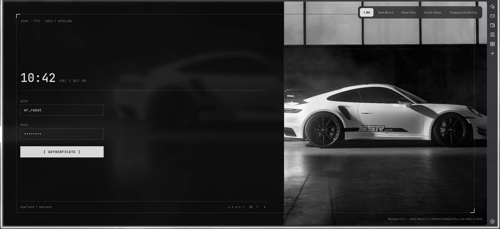
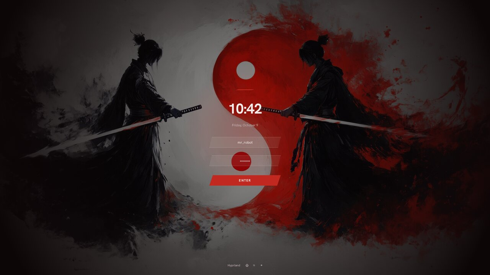
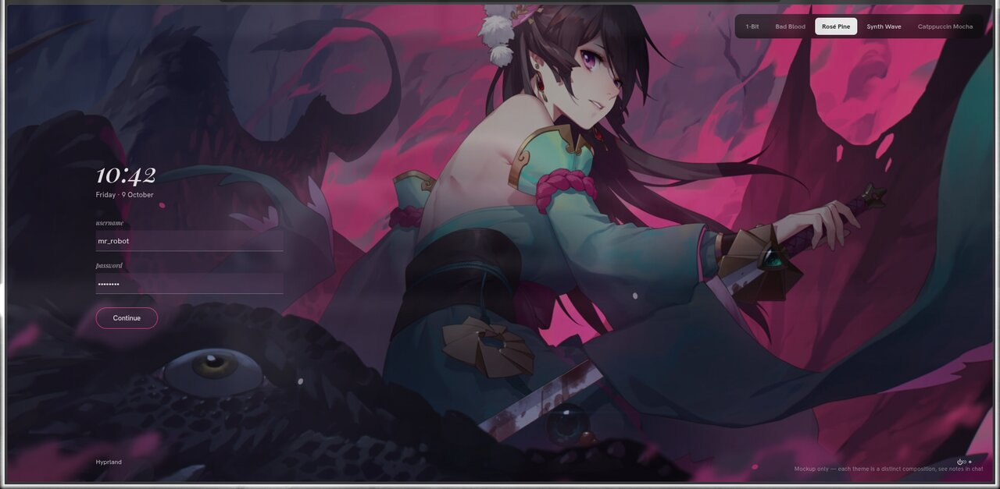
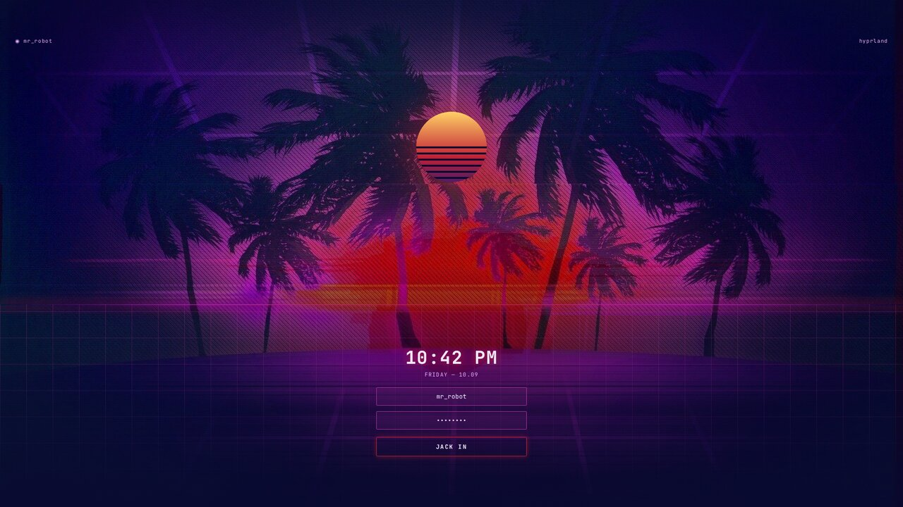
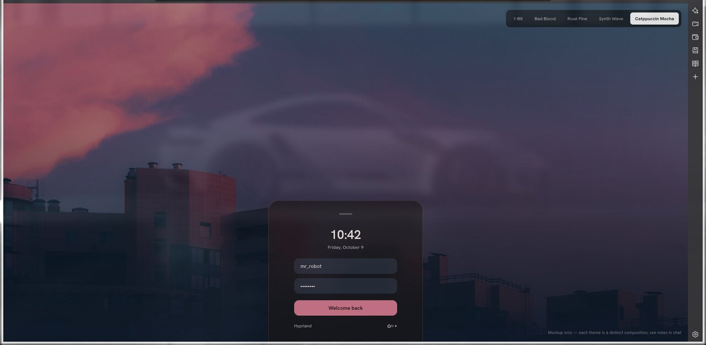

# Login screen


Stock SDDM does not follow the active HyDE theme; it stays on whatever theme was picked at install time.
`sddm/` is a custom QML SDDM theme, `hyde-wallbash`, that re-themes itself on every wallpaper change.
It has five structurally different layouts rather than one template recolored, each fed that theme's real wallbash colors and its own wallpaper.

The five themes below keep the layout they were designed around.
The other 32 are hashed onto one of the five by theme name, so a given theme always gets the same layout (`sddm/wallbash/scripts/pick_layout.py`).
Pure hashing was tried first and sent Bad Blood to the bottom-sheet layout, so the previews would not have matched the real login screen; hence the pins.

| | | |
|---|---|---|
| **1-Bit** <br>  | **Bad Blood** <br>  | **Rosé Pine** <br>  |
| **Synth Wave** <br>  | **Catppuccin Mocha** <br>  | |

These images are renders of the HTML/CSS mockups of the layouts, not screenshots of the QML greeter.
They are the page alone, with no browser around it: `assets/sddm-preview/preview.html?clean#<scene>` hides the page's own scene switcher and label.
Open it directly in a browser, or regenerate an image with Playwright's `chrome-headless-shell --screenshot=out.png --window-size=1920,1080 --hide-scrollbars --virtual-time-budget=5000 "file://$PWD/assets/sddm-preview/preview.html?clean#bad-blood"`.
Scene names: `1-bit`, `bad-blood`, `rose-pine`, `synth-wave`, `catppuccin-mocha`.

**How it stays in sync.**
`wallbash/always/sddm-wallbash.dcol` runs on every wallpaper change and calls `sddm-wallbash.sh`, which writes `/etc/sddm-wallbash/current.conf` (colors, a copy of the wallpaper, the layout number).
The greeter renders before any user session exists and runs as the `sddm` user, which cannot read `$HOME` (mode 700), so the live state lives in `/etc/sddm-wallbash/`.
That directory is group-writable by a dedicated `sddm-wallbash` group instead of sitting behind a NOPASSWD sudoers rule, so no root helper runs on each wallpaper change.
`sddm-wallbash-boot.service` runs as root before SDDM, but only checks the state file is non-empty and restores defaults if not.
It never reads anything the group can write.

**Install.**
`install.sh` must be run by hand with sudo; it points SDDM at the new theme as its last step.
Look at it first, before installing anything:

```sh
cd sddm
sddm-greeter-qt6 --test-mode --theme "$PWD/theme"    # a window, layout 1, nothing installed
sudo ./install.sh                                    # theme, group, state dir, boot unit, Current=hyde-wallbash
```

Log out and back in once afterwards so the new group membership applies.
Until then the sync hook logs a warning and skips itself; the greeter falls back to the colors baked into `theme.conf`.

Roll back by restoring the config the installer backed up first:

```sh
sudo cp /etc/sddm.conf.d/backup_the_hyde_project.conf /etc/sddm.conf.d/the_hyde_project.conf
```

**What was and was not checked.**
All five layouts load in the real `sddm-greeter-qt6` without QML errors, checked through the journal (the greeter does not log to stderr).
A deliberately broken `Main.qml` was the negative control: it logs the parse error and the greeter falls back to SDDM's built-in theme instead of crashing, so a theme that fails to load should still leave a working login.
A first `--test-mode` run turned up two real bugs the earlier checks missed.
The password field had `focus=true` but `activeFocus=false`, because the focus chain broke above it (the Loader and the layout root), so typing went nowhere until you clicked the box.
And 1-Bit drew a blinking block beside the "PASS" label that was not connected to the field at all.
Both are fixed: the field now takes focus when a layout appears and draws its own caret, and all five layouts measure `activeFocus=true`.
Not yet checked: an actual boot into this greeter on the ZBook, and the power buttons, which are hidden in `--test-mode` because SDDM reports no power capabilities there.

**Known gaps between the mockups and the real greeter.**
Only the 1-Bit layout has been looked at in a real `--test-mode` window.
Rendering all five QML layouts offscreen with each theme's own wallpaper and wallbash colors showed two that are clearly worse than their mockups:
the Catppuccin bottom sheet comes out pink with low-contrast blue text and inverted button colors, and Bad Blood's red glow becomes flat gray discs that wash out the wallpaper.
Rosé Pine's clock uses the system serif, and no layout can use blur or shader effects.
These are bugs in the QML translation, not the design, and are not fixed yet.

**Fonts.**
The QML asks only for generic `serif` and `monospace`, because the greeter runs as `sddm` and sees system fonts only.
Rosé Pine's italic clock is therefore the system serif, not the Playfair Display used in the mockup.
No GraphicalEffects or shaders anywhere, given the ZBook's GPU history; blur and glow are plain overlays and gradients.
