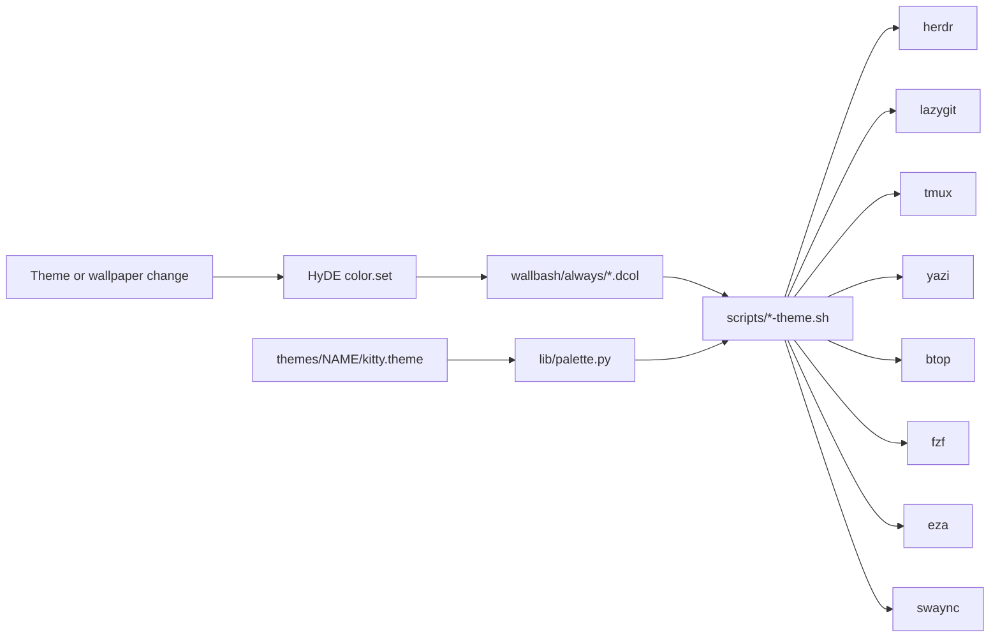

# Theme hooks

Most terminal tools know nothing about HyDE, so each one gets a small wallbash hook.
When the theme or wallpaper changes, HyDE runs every hook, and each hook rewrites one tool's colours.



## What each hook writes

| Tool | Generated file | Takes effect | Stands down when |
|---|---|---|---|
| [herdr](https://herdr.dev) | the `>>> wallbash >>>` block in `~/.config/herdr/config.toml` | live, the server is reloaded | you have your own `[theme]` table |
| lazygit | `~/.config/lazygit/wallbash.yml` | next start | never, it never touches `config.yml` |
| tmux | `~/.config/tmux/wallbash.conf`, sourced by `tmux.conf` | live, running sessions are re-sourced | never, it never touches `tmux.conf` |
| yazi | `~/.config/yazi/theme.toml` | next start | `theme.toml` is not the hook's own |
| btop | `~/.config/btop/themes/wallbash.theme` | live, btop receives `SIGUSR2` | never |
| fzf | `~/.config/fzf/wallbash.opts`, loaded through `FZF_DEFAULT_OPTS_FILE` | every new fzf | you set `FZF_DEFAULT_OPTS_FILE` yourself |
| eza | `~/.config/eza/theme.yml` | next eza | `theme.yml` is not the hook's own |
| swaync | `~/.config/swaync/wallbash-style.css`, imported by `user-style.css` | live, swaync reloads its CSS | never, see [notifications](notifications.md) |

A hook owns one generated file, so your own configuration is never edited.
The generated files are listed in `.gitignore`, so they cannot end up in a commit when stow links a whole directory into `$HOME`.

## Tools that need no hook

These use the terminal's own 16 colours, which every HyDE theme already repaints, so they follow the theme for free.

| Tool | How |
|---|---|
| starship | `cli/.config/starship/starship.toml` uses ANSI names such as `cyan` and `blue`, and `dimmed` for secondary text |
| bat | `cli/.config/bat/config` sets `--theme="ansi"` |
| fastfetch | its config only uses ANSI colour names |
| htop | the default colour scheme is ANSI |

A hex colour in any of these files would stay the same on every theme, so keep them to ANSI names.

## Where the colours come from

Every HyDE theme ships a `kitty.theme` with literal values.
`hyde/.config/hyde/wallbash/scripts/lib/palette.py` reads it and exposes named roles, so a hook never parses colours itself.
Reading the theme's own file, instead of `~/.config/kitty/theme.conf`, avoids racing the wallbash render that writes the latter.

| Role | Derived from |
|---|---|
| `bg`, `fg` | the theme's background and foreground |
| `red`, `green`, `yellow`, `blue`, `magenta`, `cyan` | ANSI colours 1 to 6 |
| `accent` | the most saturated of blue, magenta and cyan, so monochrome themes fall back to blue |
| `surface0`, `surface1` | background mixed 11% and 22% toward the foreground |
| `overlay0`, `overlay1` | background mixed 45% and 55% toward the foreground |
| `subtext0` | background mixed 78% toward the foreground |
| `surface_dim` | background darkened by 20% (5% on light themes) |

The mixing steps are the ones Catppuccin uses between its base and text colours, so light themes work without a special case.

## Same hook, three themes

The tmux and fzf hooks, run against three themes:

| Theme | tmux status bar | tmux active pane border | fzf highlight |
|---|---|---|---|
| Catppuccin Mocha | `bg=#181825,fg=#a6aec8` | `fg=#87b0f9` | `hl:#87b0f9` |
| Nier | `bg=#131614,fg=#bcbab1` | `fg=#97b7b4` | `hl:#97b7b4` |
| Gruvbox Retro | `bg=#1f1f1f,fg=#c0b393` | `fg=#448488` | `hl:#448488` |

## Write a hook for another tool

A hook is two files in the `hyde` package.

`hyde/.config/hyde/wallbash/always/mytool.dcol` is a single line telling HyDE to run the script:

```
/dev/null|${WALLBASH_SCRIPTS}/mytool-theme.sh
```

`hyde/.config/hyde/wallbash/scripts/mytool-theme.sh` writes the colours.
A minimal hook in the same shape as `lazygit-theme.sh`, the smallest real one:

```bash
#!/usr/bin/env bash
command -v lazygit >/dev/null 2>&1 || exit 0

exec python3 -I - "$(dirname "$(readlink -f "$0")")" <<'PY'
import os, sys
sys.dont_write_bytecode = True
sys.path.insert(0, os.path.join(sys.argv[1], "lib"))
import palette

p = palette.load()
if p is None:
    sys.exit(0)

h = palette.hexs
text = f"""gui:
  theme:
    activeBorderColor: ['{h(p.accent)}', 'bold']
    inactiveBorderColor: ['{h(p.overlay0)}']
    selectedLineBgColor: ['{h(p.surface1)}']
"""
out = os.path.join(palette.CONFIG_HOME, "lazygit", "wallbash.yml")
if palette.read_text(out) != text:
    palette.atomic_write(out, text)
PY
```

Guidelines:

- Exit quietly when the tool is not installed.
- Write a file you own, and leave the user's config alone.
  Where the tool has no include mechanism, mark a block with comments, as the herdr hook does, and stand down if the user has their own settings in the same place.
- Skip writing when nothing changed, so the tool is not reloaded needlessly.
- Reload a running instance only if the tool supports it cheaply.
- Add a way to run the script against a throwaway config, such as an environment variable that overrides the output path, and describe it in the script header.
- Add the generated file to `.gitignore`.
- Prefer the terminal's ANSI colours and skip the hook entirely when the tool allows it.

## Testing

Run any hook against a theme without touching your real configuration.
Each script documents its override variable in its header, for example:

```sh
HERDR_CONFIG_PATH=/tmp/herdr.toml \
HYDE_THEME_DIR=~/.config/hyde/themes/Nier \
  ~/.config/hyde/wallbash/scripts/herdr-theme.sh
```

CI runs every hook against a theme with stand-in binaries and checks that the files exist and that the TOML parses.
Locally, a quick sweep over every theme looks like this:

```sh
for d in ~/.config/hyde/themes/*/; do
  HYDE_THEME_DIR="$d" XDG_CONFIG_HOME=/tmp/wb ~/.config/hyde/wallbash/scripts/lazygit-theme.sh
done
```

## Known limits

- lazygit and yazi keep their old colours until restarted.
- The lazygit and fzf variables are exported for bash and zsh only (`shell/.config/shell/wallbash-env.sh`), not fish.
- A few themes ship weak ANSI colours, for example a very dim bright black in Oregairu and Chisa, and a low-contrast blue in Chisa.
  That is why the hooks use derived greys for secondary text.
  Starship's `dimmed` and ANSI blue still depend on the theme.
